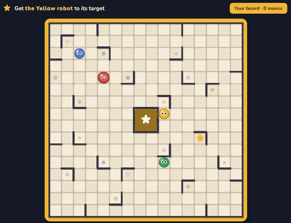

# Project Ricochet

**Play it in your browser: [ricochet.thomasliu.dev](https://ricochet.thomasliu.dev)** (desktop browsers; share a
lobby code with friends to play together)



A competitive multiplayer puzzle game. Every player gets the same board: robots slide in a straight
line until they hit a wall or another robot, and the goal is to get the target robot onto the target
square in as few moves as possible. The first solution starts a timer, shorter solutions extend it,
and the shortest solution when time runs out wins the round.

Prototype stage: the gameplay and multiplayer are complete; the art and UI are still placeholders.

## Highlights

- **Optimal solver.** Iterative-deepening A* with an admissible per-cell lower bound and a transposition
  table that treats interchangeable robots as one state. It proves the shortest solution of a typical board
  in under a millisecond (p99 ~40 ms over 2,000 boards), so every round can end the moment someone finds the
  optimum and replay it afterwards.
- **Board search.** Boards are dealt with a minimum (or exact) solution length. Long boards are rare (about
  1 in 350 random boards needs 14+ moves), so the search hill-climbs: it nudges robots and keeps changes
  that don't make the puzzle shorter, which finds them several times faster than rerolling. The same code
  runs on the server and, spread over frames, in the browser.
- **Server-authoritative multiplayer.** ASP.NET Core SignalR server with lobbies, hosts, match settings,
  round timers, votes and replays. It validates every solution, survives disconnects (seats are kept so
  players can rejoin with their score) and never trusts the client.
- **One codebase, two runtimes.** The rules, solver and wire formats are a plain C# library compiled by both
  .NET and Unity. In the browser build (WebGL), which has no sockets or threads, the client talks to the
  server through a small JavaScript bridge to the SignalR JS client.
- **Tested and deployed.** 200+ xUnit tests (rules, solver, board generation, the server's lobby/match logic
  with a fake clock, and the client's state). GitHub Actions runs them on every push and deploys the server
  as a Docker image to AWS EC2 behind Caddy (automatic HTTPS).
- **Everything drawn in code.** Board, robots, effects and sounds are generated at runtime (no art assets yet).

## How it's built

| Folder | What it is |
|---|---|
| `SharedLogic/` | Game rules, board generator, board search and optimal solver in plain C#, used by both the server and the Unity client |
| `BackendServer/` | ASP.NET Core SignalR server: lobbies, matches and round timers. It has the final say on every move |
| `UnityClient/` | Unity 6 game client (browser build via WebGL) |
| `*.Tests/` | xUnit tests for the rules, the server's lobby/match logic and the client's state |
| `deploy/`, `.github/` | Docker Compose + Caddy setup and the CI/deploy workflow |

## Running it locally

Needs the .NET 9 SDK, and Unity 6 (6000.6.5f1) for the client.

```
dotnet test RicochetGame.sln
dotnet run --project BackendServer --launch-profile http
```

To play against the local server in a browser, build the client once with `Tools/build-web.sh` (Unity
closed), then run `Tools/dev-session.sh`. It starts the server, serves the build and prints the address to open
(`http://localhost:8080/?server=http://localhost:5022&lobby=DEV`). Open it in two tabs to play against yourself.

In the Unity Editor, open `Assets/Scenes/Scratchpad.unity` and press Play. The Editor uses the cloud server
unless it's started with `-server http://localhost:5022`.

## License

Copyright (c) 2026 Thomas Liu. All rights reserved.

The source is published so people can read it. No license is granted to copy, modify, distribute or
sell this code or the game, in whole or in part. Third-party components keep their own licenses; see
[THIRD-PARTY-NOTICES.md](THIRD-PARTY-NOTICES.md).

Inspired by the board game *Ricochet Robots*. This project isn't affiliated with or endorsed by its
designer or publishers, and uses its own board layouts.
